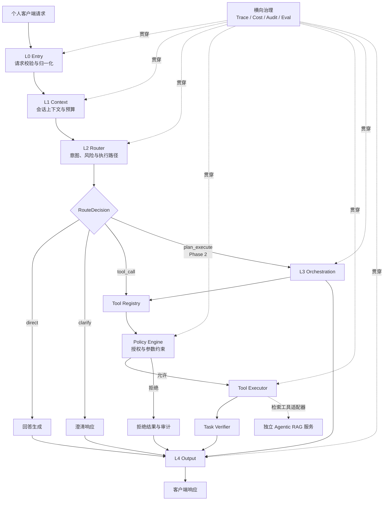

# HostPilot 架构设计（初版）

- 文档状态：架构基线草案
- 版本：0.1
- 更新日期：2026-10-28
- 适用范围：供个人客户端使用的 Agent 后端
- 关联文档：[需求基线](requirements.md)、[实施路线](roadmap.md)、[依赖管理](dependency-management.md)、[测试策略](testing-strategy.md)

> 本文依据项目当前目标整理。HostPilot 的主体是个人终端上的 Agent 后端，不是多租户 Agent 托管平台；当前版本由同一终端上的独立 Web 前端操作，免登录并支持多个独立会话。Agentic RAG 属于后续独立项目，在 HostPilot 中仅作为检索工具接入；其服务侧可面向多用户并自行负责对应的身份、租户和数据隔离。当前处于早期实现阶段：本地 Skill 管理和确认门已有首版实现，L0–L4 主请求流程尚未完成。

## 1. 目标与范围

HostPilot 为个人客户端提供可控、可扩展、可观测的 Agent 主流程，负责请求理解、上下文组织、执行路径选择、工具使用治理、执行结果验证和响应输出。

本项目的架构目标：

- 为同一终端上的单个本地用户提供 Agent 执行与治理能力，并支持多个相互隔离的会话。
- 通过明确的工具契约扩展能力，调用前执行策略检查，并验证工具结果。
- 支持可替换的模型、工具和检索服务适配器。
- 对模型调用、工具调用和检索调用实施预算、超时和审计。
- 先交付受控单步主路径，再分阶段加入复杂编排与代码沙箱。

本项目当前不承担：

- 多租户 Agent 托管、租户管理或跨用户 Agent 执行。
- Agentic RAG 的索引、召回、重排、证据评分和内部 Agentic 循环实现。
- 未经确认的生产部署拓扑、身份服务、数据库或消息系统选型。

HostPilot 与独立 Agentic RAG 项目的关系是“Agent 客户端调用检索工具”。检索服务内部的多用户认证、授权、索引隔离与数据治理由该独立项目负责；HostPilot 负责整理自包含的检索请求、按工具策略发起调用，并消费带来源信息的结果。两侧的身份凭证传递与权限协议尚需单独确认。

## 2. 架构驱动因素

| 驱动因素            | 架构响应                                                   |
| --------------- | ------------------------------------------------------ |
| 单终端个人使用         | 前后端运行在同一终端，当前免登录；多个会话通过 conversation_id 隔离，不引入 Agent 平台租户层                    |
| Agent 工具调用具有副作用 | 工具统一登记，调用前执行授权和参数约束，执行后验证结果                            |
| 模型和集成供应方可能变化    | 通过稳定的领域契约隔离模型、工具、检索和沙箱适配器                              |
| 外部 RAG 单独演进     | HostPilot 只依赖检索工具契约，不内嵌 RAG 项目的内部编排                    |
| 长任务和代码执行风险较高    | 计划编排、Agentic Retrieval 和沙箱按阶段启用，并分别限制预算和资源             |
| 运行过程需要复查        | Trace、Cost、Audit、Policy Decision 和检索 Evidence 使用关联标识串联 |

## 3. 架构原则

1. **先治理，后执行。** 工具授权、参数约束和预算检查必须在副作用之前完成；隔离环境的选择不能替代授权。
2. **核心流程属于 HostPilot。** 请求上下文、路由、工具治理和响应流程由 HostPilot 控制；外部检索服务保持独立。
3. **外部输入均不可信。** 模型输出、计划、检索证据及工具返回值都不能改变 HostPilot 的授权规则。
4. **通过契约隔离实现。** 核心业务逻辑依赖稳定 DTO / Protocol，不直接依赖特定模型框架或服务 SDK。
5. **上下文与预算显式传递。** 请求所需的用户会话上下文、预算和授权决定不得依赖隐式全局状态。
6. **最小权限和明确副作用。** 未声明或未批准的 capability 默认拒绝；高影响操作需要可审计的策略决策。
7. **Skill 内容不授予权限。** 本地 Skill 是不可信指令数据；工具仍经 Policy Engine 授权，高影响操作另需用户明确确认。
8. **按阶段引入复杂度。** Phase 1 不依赖 DAG 多 Agent 编排、Agentic Retrieval 内部循环或代码沙箱。
9. **区分架构目标与实现状态。** 文档中的目标模块不代表功能已经交付；未决方案通过 ADR 管理。

## 4. 系统上下文与逻辑架构

### 4.1 系统边界

**HostPilot 内部负责：**

- 客户端请求接入、会话上下文准备和执行预算；当前本地 Web 操作免登录并支持多个独立会话。
- 使用 SQLite 持久化会话索引与 LangGraph 检查点，使用 Markdown 保存会话摘要和跨会话长期记忆。
- 通过 FastAPI 提供后端 HTTP API；Web 前端属于独立项目，通过 API 契约与 HostPilot 对接。
- 为前端提供实际注册工具的只读目录；只返回用途、配置状态和审批要求，不返回工具参数 schema 或凭证。
- 为本地进度看板提供 FastAPI WebSocket 状态通道；当前仅推送健康快照并响应心跳，阶段数据随前端版本维护。
- Agent 路由、Skill 发现与回答流程。
- LangChain / LangGraph / DeepAgents 适配边界，以及开发期 Gradio 原型入口。
- Tool Registry、Policy Engine、Tool Executor 和 Task Verifier。
- 检索工具客户端边界、结果校验和调用追踪。
- 输出安全复核、格式化和记忆写入提案。
- HostPilot 自身的配置、日志、Trace、Cost 与 Audit 契约。

**独立 Agentic RAG 项目负责：**

- 检索数据接入、索引、召回、重排、证据评估与 Agentic Retrieval。
- 面向其多用户场景的认证授权、租户隔离及数据范围实施。
- 检索服务内部预算、循环上限和数据治理。
- 对外提供稳定的检索接口和 EvidenceSet 响应。

\*\*外部依赖包括：\*\*模型提供方、确定性业务工具、独立检索服务和（Phase 3）沙箱运行时。具体供应方与部署方式待决策。

### 4.2 主流程



Router 产生四种逻辑决策：direct、clarify、tool\_call、plan\_execute。plan\_execute 是 Phase 2 能力；未启用时不得将请求隐式升级到未受控的计划执行路径。RAG 服务是外部依赖，通过检索工具适配器接入，不属于 HostPilot 的 L0–L4 层级。

### 4.3 逻辑分层

| 层 / 边界                  | 职责                                         | 主要模块                                      | 阶段                                |
| ----------------------- | ------------------------------------------ | ----------------------------------------- | --------------------------------- |
| L0 Entry                | 接收并校验客户端请求、归一化输入、限流及基础安全初筛                 | entry                                     | 基础层                               |
| L1 Context              | 读取必要会话状态、初始化预算、创建请求上下文快照                   | context、budget                            | 基础层                               |
| L2 Router               | 判断意图、复杂度和风险，选择回答、澄清、工具或计划路径                | routing                                   | 基础层                               |
| Skill Boundary          | 本地 Skill 发现、结构校验、按需加载并交给 DeepAgents 适配器          | skills                                    | Phase 1                           |
| Tool Path               | 工具描述与登记、调用前授权、执行和结果验证                      | tools、policy、verification                 | Phase 1                           |
| Retrieval Tool Boundary | 将已解析 query、过滤条件和预算映射到外部检索服务，校验 EvidenceSet | retrieval                                 | fast 模式 Phase 1；agentic 模式由外部项目提供 |
| L3 Orchestration        | 计划审查、DAG 调度、子 Agent 执行、有限重规划与结果聚合          | orchestration                             | Phase 2                           |
| L4 Output               | 输出校验、策略复核、记忆提案和响应格式化                       | output、memory                             | 基础层                               |
| Cross-cutting           | 统一配置、契约、Trace、Cost、Audit 与 Eval            | config、contracts、observability、evaluation | 逐步完善                              |
| Sandbox Boundary        | 按信任级别和平台选择隔离执行后端并限制资源                      | sandbox                                   | Phase 3                           |

Tool Path 与 Retrieval Tool Boundary 是执行能力边界，不是额外的编号层。检索服务的多用户隔离由独立 RAG 项目拥有；HostPilot 不在主 Agent 内复制 RAG 租户管理。

## 5. 核心流程

### 5.1 请求准备与路由

1. Entry 接收同一终端上 Web 前端发出的请求，执行结构、大小、速率和基础安全校验；当前本地单用户场景不要求登录。默认不接受来自其他终端的访问。
2. Context Builder 使用 conversation_id 读取 SQLite 中的会话检查点，并将该 ID 映射为 LangGraph thread_id；再按需读取对应会话摘要和相关长期 Markdown 记忆，生成 ContextSnapshot 并初始化 BudgetContext。会话间不得共享隐式上下文。
3. Router 根据请求与上下文形成 RouteDecision。当前命令 Router 支持 `/read <path>` 和 `/write <path>` 后接换行内容；其他普通消息保持 direct 路径，写命令缺少路径或内容时返回 clarify。模型给出的工具名称或计划不能作为授权依据。
4. direct 路径进入回答生成；clarify 路径返回澄清请求；tool\_call 进入统一工具治理流程。

### 5.2 Skill 发现与执行

Skill 是指导 Agent 完成一类任务的指令和资源包，不是授权凭证，也不是工具本身。Skill Resolver 默认从 ~/.hostpilot/skills（或 HOSTPILOT_SKILLS_DIR 指定的目录）发现包，校验元数据和规范化路径后按需加载 DeepAgents 标准 YAML frontmatter 的 SKILL.md 与受限文本资源；用户修改后重新扫描和校验再加载。

DeepAgents 适配器只向 Agent 提供已验证的 Skill 内容。Skill 内容一律按不可信输入处理；首版加载不执行包内代码。Skill 可请求使用工具，但每次工具调用仍走 HostPilot Tool Registry、Policy Engine 和 Tool Executor。

对高影响操作，Policy Engine 授权后，HostPilot 还必须向用户说明拟执行的操作并取得明确确认。确认拒绝、取消或超时均阻止执行；用户确认不能覆盖策略拒绝。确认结果与 Skill 标识、版本/内容指纹一并写入审计。

当前 WebSocket 聊天在执行高影响工具前发送 `tool.confirmation.request`，只展示工具名和安全摘要；客户端通过带匹配 `request_id` 的 `tool.confirmation.decision` 回复。审批最多等待 60 秒，超时或断开连接都会阻止执行。HTTP 聊天暂不提供交互式审批，因此高影响调用会 fail-closed。

### 5.3 工具执行与验证

1. Tool Registry 提供声明式 ToolDescriptor，至少描述工具类型、信任级别、执行环境和超时配置。
2. Policy Engine 检查工具、参数、用户权限、数据范围、预算和 capability。
3. 仅获准调用交由 Tool Executor 执行；拒绝分支不得触发工具副作用，并应记录可区分的拒绝原因。
4. 确定性 API、数据库或客户端工具通过各自适配器执行。当前内置 MCP 工具由 HostPilot 进程内的 FastMCP Server 提供，FastMCP Client 通过内存会话连接；配置的远程 MCP Server 则各自建立 Streamable HTTP Client 会话。所有 MCP 工具调用仍须进入 HostPilot Tool Registry、Policy Engine 和 Tool Executor，不得绕过授权链。相关决定见 [ADR-0007](decisions/0007-in-process-fastmcp-tools.md) 和 [ADR-0008](decisions/0008-remote-mcp-servers.md)。
5. Task Verifier 检查执行状态、返回结构与任务约束，结果交给 L4 统一处理。
6. 超时、预算耗尽和外部服务故障必须形成明确状态，不能伪装为成功。

首批内置文件工具为 `read_text_file` 和 `write_text_file`。工具根目录是后端进程的启动工作目录；仅接受 UTF-8 文本并限制单文件大小，拒绝绝对路径、路径穿越、符号链接和不存在的父目录。读取是只读操作；写入属于高影响操作，须先通过策略，再取得 WebSocket 用户批准。

远程 MCP Server 从 `HOSTPILOT_MCP_SERVERS` JSON 配置读取，每个 Server 对应一个独立 FastMCP Client 和会话。远程工具发现后以 `{server_name}_{tool_name}` 暴露，避免同名冲突；描述和参数 schema 来自远程 Server。远程调用默认标记为第三方服务上的高影响操作，必须经 WebSocket 用户审批后才能发送请求。远程 Server 声明的工具注解不作为 HostPilot 的授权依据。

### 5.4 外部检索工具调用

当前 FastMCP 知识库工具作为普通只读工具接入 Tool Registry、Policy Engine 和 Tool Executor。模型调用时只提交 query。用户在本地配置完整的 RAG 服务信息后，后端工具会调用独立 Agentic RAG HTTP 服务；未配置时返回“知识库暂未开启”。

当前客户端按以下接口基线连接检索服务：

```
POST {RAG_BASE_URL}{RAG_RETRIEVAL_PATH}  { user_id, key, query } -> EvidenceSet
```

后端使用 RAG_BASE_URL、RAG_RETRIEVAL_PATH、RAG_USER_ID、RAG_KEY 和 RAG_TIMEOUT_SECONDS 配置客户端；RAG_USER_ID 与 RAG_KEY 注入请求体，MCP schema 不含身份和密钥，响应按 EvidenceSet 校验。配置不完整时启动配置校验会失败。Agentic RAG 的内部改写、召回、重排、证据评分和迭代由外部项目实现；真实服务联调时仍需验证 URL、路径和响应 JSON 与此接口基线一致。

这里的 MCP Client 与内置 MCP Server 同处 HostPilot 进程，通过 FastMCP 内存传输连接；RAG 服务则是独立服务，由 `retrieve_knowledge` 工具通过 HTTP 请求。HostPilot 当前没有为这些内置工具启动本地 stdio 子进程，也没有把 RAG 服务作为第二个 MCP Server 连接。

配置远程 MCP Server 时，HostPilot 为每个端点创建一个使用 Streamable HTTP 的 FastMCP Client，会话之间独立管理。此接入要求远端提供 MCP Streamable HTTP 端点；普通 REST API（包括当前 RAG HTTP 接口）不能直接作为 MCP Server 使用。

### 5.5 计划执行与输出

Phase 2 中，Planner 生成候选计划，Plan Critic 先行审核，Orchestrator 按 DAG 依赖调度子任务。子 Agent 使用隔离上下文，依赖由 Orchestrator 显式注入；任务结果经过验证后聚合。局部重规划和重试必须有上限。

所有路径汇入 L4。Output Validator 检查结构和安全约束，Policy Checker 进行输出侧复核，Response Formatter 生成客户端响应。记忆更新以 MemoryWriteProposal 表达，经策略处理后更新 Markdown 摘要或长期记忆；模型不能直接写入持久记忆。

## 6. 模块与代码组织

以下是目标模块边界。目录已预留不代表能力已经实现。

| 包             | 主要职责                                                                |
| ------------- | ------------------------------------------------------------------- |
| entry         | 客户端请求入口、输入校验与归一化                                                    |
| context       | 会话状态读取边界与 ContextSnapshot 生成                                        |
| routing       | RouteDecision 与路由规则                                                 |
| budget        | 请求预算、子预算及消耗记录                                                       |
| contracts     | 跨模块 DTO、Protocol、错误和事件类型                                            |
| policy        | 工具与输出策略决策、参数约束和 capability 授权                                       |
| skills        | 本地 Skill 包发现、校验、内容指纹、按需解析及框架适配器边界                       |
| tools         | ToolDescriptor、Registry、Executor 与工具适配器                             |
| verification  | Task Verifier 与验证结果                                                 |
| retrieval     | 外部 RAG 服务的客户端适配、检索请求/响应契约和结果校验                                      |
| orchestration | Phase 2 Planner、Critic、DAG 调度、Executor Agent、Replanner 与 Aggregator |
| output        | 输出校验、策略复核与响应格式化                                                     |
| memory        | MemoryWriteProposal、会话摘要与 Markdown 长期记忆适配边界                                       |
| sandbox       | SandboxPolicy、后端路由及隔离后端适配                                           |
| observability | Trace、Cost、Audit 事件与导出接口                                            |
| evaluation    | 评测接口、数据集和评测结果                                                       |
| config        | 配置加载、类型校验和安全默认值                                                     |

模块按实际规模建立 domain、application、adapters 等子包，不为未实现能力预造重复空目录。测试统一放在根 tests 下，按 unit、integration、security、fixtures 分类并映射到模块。

## 7. 契约与依赖方向

### 7.1 核心契约

跨模块数据优先在 contracts 中定义。当前需要的主要契约：

- **ContextSnapshot**：当前请求所需的客户端会话上下文；只保留必要数据。
- **BudgetContext**：预算上限、消耗和子预算边界。
- **RouteDecision**：路由类型、决策元数据及适用约束。
- **ToolDescriptor**：tool\_type、trust\_level、execution\_env、timeout\_profile 及策略所需声明。
- **RetrievalToolRequest / EvidenceSet**：自包含 query、mode、filters、budget，以及带来源信息的证据。
- **SandboxPolicy**：批准的 capability、资源限制和策略决策。

Phase 0 已为 ContextSnapshot、BudgetContext、RouteDecision、ToolDescriptor、RetrievalToolRequest、EvidenceSet 和 SandboxPolicy 建立首版 Pydantic 契约，并统一拒绝未声明字段。字段会随模块需求演进；HTTP API 序列化与版本策略仍待后续确认。

### 7.2 依赖规则

建议的核心依赖方向：

```
entry -> context / routing
context / routing -> contracts / budget
tools -> policy / contracts / adapters
retrieval -> contracts / 外部 RAG 客户端适配器
orchestration -> contracts / routing / tools / verification
output -> contracts / policy / memory
各模块仅依赖必要的 config / observability 接口
```

- contracts 不依赖业务模块或外部框架。
- 领域与应用逻辑不反向依赖 Web、数据库、客户端 UI 或供应方适配器。
- 外部 RAG 客户端实现 HostPilot 定义的契约；RAG 服务内部模型和索引类型不泄漏到 HostPilot 核心。
- 不通过共享可变全局对象隐式传递上下文、预算或授权状态。
- FastAPI 用于 HostPilot 后端 HTTP API；Web 前端由独立项目开发，通过稳定的请求 / 响应契约调用后端。
- LangChain 用于模型和工具集成；LangGraph 管理 HostPilot 顶层流程；DeepAgents 通过适配边界提供 Skill 等 Agent 能力。顶层请求编排由 LangGraph 控制，避免另建无约束的并行执行循环。Gradio 仅服务开发期原型。具体 API 兼容性仍需验证。
- 仓库配置为 Python 3.11+ 与 uv；生产运行环境仍待确认。

## 8. 安全与治理

### 8.1 HostPilot 责任

- Policy Engine 是 HostPilot 工具授权的唯一权威入口；未声明或未批准的 capability 默认拒绝。
- 模型输出、计划、检索文本和工具响应均视为不可信数据，不能改变授权规则。
- 高影响副作用需要明确策略决策；拒绝、参数校验失败、预算耗尽应能区分。
- 确定性 API / DB 工具仍需经过策略检查；可信运行环境不等同于获准访问。
- LLM 生成脚本和不可信工具仅在 Phase 3 接入沙箱。WASM 默认无网络、无文件系统和无宿主函数；其他后端按能力模型显式授权。
- Trace 和日志遵循最少必要原则，不记录密钥、完整敏感会话内容或不必要的提示词。

### 8.2 检索项目责任

独立 Agentic RAG 服务负责其多用户场景中的用户认证、租户识别、索引和数据范围隔离、检索侧审计及内部预算。HostPilot 不宣称替 RAG 服务提供这些隔离保证。HostPilot 调用时应使用经批准的服务凭证和明确的用户 / 数据范围映射；具体协议在联调前确定。

### 8.3 横向治理

使用关联标识串联路由、模型、策略、工具、检索、验证和输出事件。HostPilot 记录请求级耗时、预算变化、决策类别、工具标识、调用状态和检索引用标识。Eval 与运行时授权分离，评测结果不能替代生产策略判断。

## 9. 质量属性与验证方向

| 属性     | 架构策略                            | 验证重点               |
| ------ | ------------------------------- | ------------------ |
| 安全性    | 默认拒绝、先授权后执行、capability 最小化      | 未授权调用、注入输入、沙箱越权拒绝  |
| 用户数据保护 | 控制 HostPilot 会话数据读取，并明确外部服务数据责任 | 会话访问边界、凭证保护、检索用户映射 |
| 可控性    | 预算、超时、迭代及资源限制                   | 超限停止、部分结果与明确失败状态   |
| 可观测性   | 统一关联 Trace 与策略 / 工具事件           | 跨模块关联完整、日志不泄漏敏感数据  |
| 可测试性   | 契约隔离外部依赖，核心逻辑可替身化               | 单元、契约、集成、安全和端到端测试  |
| 可扩展性   | 通过适配器隔离模型、工具与 RAG 服务            | 替换适配器时核心契约稳定       |
| 可维护性   | 领域模块边界和依赖方向清晰                   | 无循环依赖，文档与实现状态一致    |

性能、可用性、并发量和成本目标尚未确认，本版不设未经验证的数值。建立运行基线后，应补充可测量的服务目标。

## 10. 分阶段交付

| 阶段              | HostPilot 交付                                                  | 阶段边界                                                 |
| --------------- | ------------------------------------------------------------- | ---------------------------------------------------- |
| Phase 0：项目基线    | 核心契约、配置与遥测接口、依赖锁定、CI 和开发规范                                    | 不提前定案未确认的生产部署选型                                      |
| Phase 1：受控主路径   | L0–L2、工具登记与策略、确定性工具执行、结果验证、L4、外部检索工具 fast 接口、基础 Trace / Audit | 不包含 DAG 计划执行、内部 Agentic RAG 循环或代码沙箱                  |
| Phase 2：编排扩展    | 受控 plan\_execute、DAG Orchestrator、隔离上下文子 Agent、有限重规划与结果聚合     | Agentic Retrieval 的实现仍属于独立 RAG 项目；HostPilot 只消费其工具接口 |
| Phase 3：不可信代码隔离 | Sandbox Router、策略驱动后端、资源约束与 capability 审计                     | 不把所有确定性 API / DB 工具强制放入代码沙箱                          |

阶段验收和测试记录遵循 [实施路线](roadmap.md) 与 [测试策略](testing-strategy.md)。

## 11. 待确认事项与文档对齐

### 11.1 架构决策待确认

1. 后端运行入口、启动与打包方式。
2. 会话与长期记忆保留期限、备份及数据库迁移策略。
3. 审计事件保留策略。
4. LangChain、LangGraph 与 DeepAgents 的具体 API 版本兼容性及 Skill 加载适配细节。
5. 高影响操作分类标准及 LangGraph 用户确认中断/恢复接口。
6. Agentic RAG 服务的接口协议、身份凭证传递、用户映射和过滤语义。
7. Phase 3 首选沙箱后端、支持平台和交付优先级。
8. 性能、可用性、延迟、成本、数据驻留及灾备目标。

确认后在 requirements.md 或 ADR 中记录结论，并同步本架构文档。

### 11.2 与现有需求材料的对齐

需求基线现已按本文范围对齐：HostPilot 的 Agent 主流程面向个人客户端，不承担多租户 Agent 管理；Agentic RAG 作为独立项目，其多用户检索、索引隔离和内部 Agentic Retrieval 由该项目负责。HostPilot 仅通过检索工具契约集成，并负责自身的调用授权、凭证保护和接口验证。

## 12. 状态维护

- 本文描述目标架构；尚未实现的能力不得标记为已交付。
- 需求、实现和架构出现差异时，通过需求更新或 ADR 明确变化原因、影响和迁移要求。
- 新模块开发前确认模块职责、契约、依赖方向、安全边界及测试位置。
- 每阶段结束后记录交付范围、实际测试结果、覆盖缺口和已知风险。

