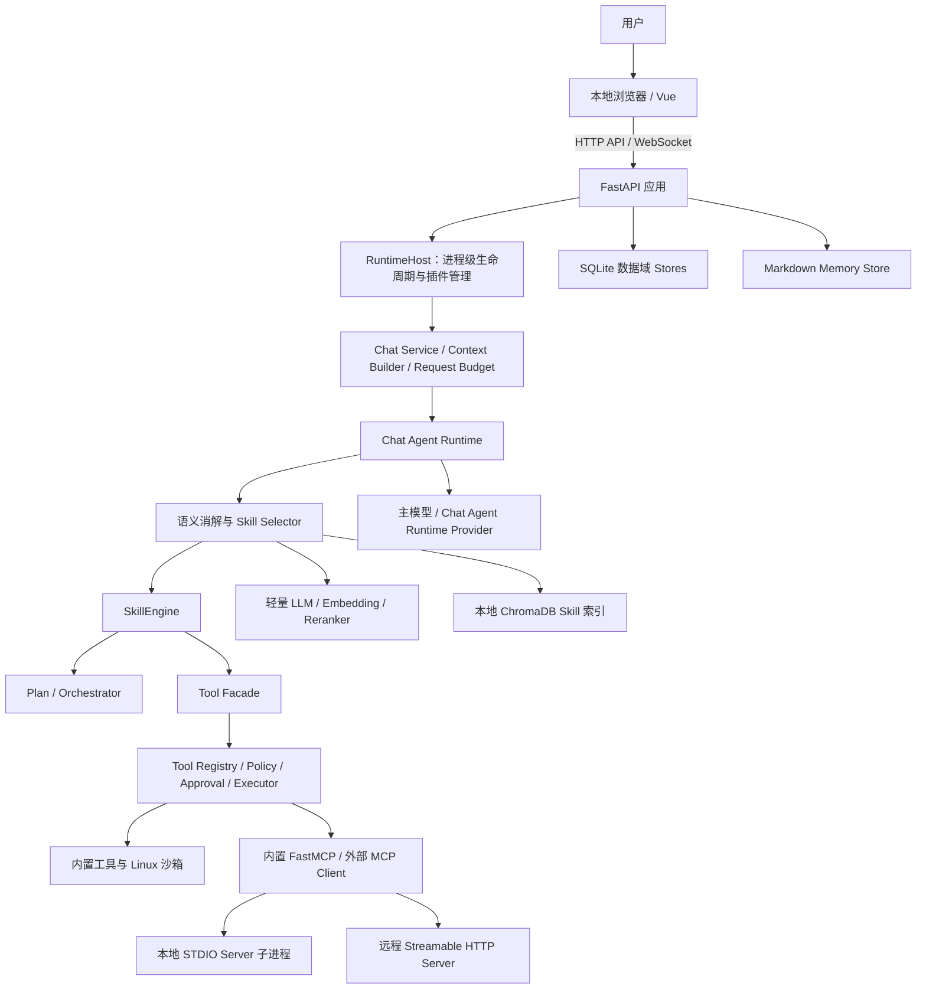

# HostPilot 当前架构

本文描述仓库当前实现和明确的产品边界，只维护现状，不记录历史方案或修订过程。测试数字与逐项验证记录维护在[测试指标台账](testing-metrics.md)及其链接的报告中。

## 产品边界

HostPilot 是面向 Linux 的本地 Agent 基座。用户通过本机浏览器访问 Vue Web 前端，前端连接本机 FastAPI 服务；Agent 在后端完成对话、Skill 执行、工具治理和持久化。Windows Agent 尚未开发，计划在 Linux 版本完成后单独开发。



每个 ASGI worker 进程由 FastAPI/Uvicorn 驱动事件循环，并在应用 lifespan 中创建一个 `RuntimeHost`。Host 不另起一条主循环；它负责共享运行时上下文、按插件依赖启动服务、管理插件后台任务，并在应用关闭时按相反顺序清理资源。当前 Host 通过 `builtin.chat-execution` 插件持有和替换组合式 Chat Agent Runtime。

当前 Host 通过 `builtin.configuration-stores` 创建、初始化并持有模型、路由模型、MCP、Harness、Workspace 和 Skill Execution 配置 Store；`builtin.application-stores` 管理 Trace、Audit、Cancellation 和 Memory Store。FastAPI 在 Host ready 后从服务注册表读取配置及这些 Store。`builtin.mcp-provider` 持有活动 MCP Provider；`builtin.tool-governance` 注册稳定的 `hostpilot.tool-facade` 服务，并在 Provider 替换提交后更新代理目标；同时注册 `hostpilot.tool-governance` 工厂，由 Runtime 为每个 MCP Provider Registry 创建独立 `ToolExecutionScope` 与 `ToolInvocationCoordinator`。默认 Scope 私有封装现有 ToolExecutor；协调器选择主/补偿 Scope 并转发经过治理的执行请求。`builtin.sandbox-backends` 在 RuntimeHost 启动时创建并注册共享 Sandbox 后端集合；MCP Provider 依赖该插件，初始 Provider 与 MCP/Model 配置刷新候选共用同一集合。候选 Provider 仍各自创建 Workspace、Registry 和治理状态。Linux 后端仍逐次执行 bubblewrap 隔离进程，后端对象不持有常驻进程；可用性探测继续懒加载。MCP Provider 保留 Registry、MCP Client、路由、传输回调和远端超时结果翻译；本地、远程、FastMCP 拦截和补偿执行均经过 Runtime 协调器。Provider 替换时新 Scope 和协调器随候选 Provider 创建，Facade 身份保持稳定；资源仍由 `builtin.mcp-provider` 释放。`builtin.routing-models` 管理 Judge/Embedding/Reranker Provider 的替换并在 Host 停止时关闭当前及退役实例；`builtin.state-services` 从工厂创建并初始化 ConversationStore、打开注入工厂提供的 Checkpointer 上下文，再由依赖 State/MCP/Tool Governance 服务的 `builtin.chat-execution` 持有 ChatAgentRuntime，并在替换或停机时关闭主模型客户端。停机时按依赖逆序关闭 ChatAgentRuntime、Tool Facade 绑定、Checkpointer、ConversationStore、MCP Provider、路由模型 Provider、应用 Store 和配置 Store。SQLite 是默认 Store/Checkpointer 实现，具体实现可通过工厂替换。Runtime 的请求级 RequestContext 聚合 ContextSnapshot、活动 RequestBudget 和可选审批能力；ChatService 每个 Turn 创建它，并将同一对象沿 ChatAgentRuntime、Skill Selector、SkillEngine 和 Plan/DeepAgents 处理链传递。Chat Runtime 插件 API 为 2.0。LangGraph 适配器在工具上下文边界将其转换为现有 `snapshot`、`budget`、`confirmation_provider` Mapping，缺失审批能力仍映射为 `None`；模型与工具 Port 暂保留既有调用形状，由适配边界读取请求字段。请求数据不会写入进程共享 RuntimeContext，route-only 评测路径不变。共享 RuntimeContext 还提供进程内 Turn 生命周期管理：记录活动 Turn、完成/失败/取消状态，并支持按 Turn、Session 或 Host 关闭取消；该元数据目前不持久化。

这是 Runtime Core 的分阶段拆分：Host、配置/应用 Store、State/Checkpoint、MCP、路由模型及 Sandbox 后端、稳定 Tool Facade、ToolExecutionScope 和 ToolInvocationCoordinator 工厂及 Chat Agent Runtime 生命周期已交由插件管理；Runtime 协调主/补偿执行，MCP Provider 保留传输路由、调用回调、Workspace 和资源清理。请求级 RequestContext 已从 ChatService 贯穿 ChatAgentRuntime、Skill Selector、SkillEngine 与 Plan/DeepAgents 链；LangGraph 在工具上下文边界转换为现有字段，模型与工具 Port 暂保留原调用形状。Chat Runtime 插件 API 为 2.0。`DefaultRuntimeExecutionLoop` 已提供有界 Model/Tool 循环，并通过 ModelProvider 与 ToolFacade 适配器复用共享预算及现有工具治理；它以本轮消息为输入并返回消息增量，不负责 Session/Checkpointer。默认 `builtin.runtime-chat` 使用 Runtime-native Model/Tool 循环、Prompt/Memory Builder 和 LangGraph Checkpoint State Adapter；YAML Skill 由 SkillEngine 执行，Markdown Skill 仍通过统一 SkillExecutor 契约委托 DeepAgents/LangGraph。`builtin.deepagents` 保留为可显式选择的兼容 Chat Runtime，不再是默认控制路径。Turn 和 Plan TaskRun 生命周期元数据由 TurnStore/TaskStore 持久化；成功 Plan 子任务的说明、显式输入、依赖 ID 和 JSON 输出也保存在独立结果表，新 Turn 可将同一 Session 最近最多 32 项且总 payload 不超过 65,536 字节交给 Planner 重新规划。历史结果不自动完成新 Plan 任务；失败/中断任务不提供可复用输出。工具结果 checkpoint 缺失时，Runtime 持续阻断同一 Session 后续执行，并提供人工核实入口；核实结果写入原工具调用的 Checkpoint，后续 Plan 可重新规划。系统尚不恢复旧 Plan DAG 或执行游标，也不自动重放工具。`create_configured_chat_agent_runtime()` 仍负责组装 Model、Selector、Skill 与 Plan。数据库、模型供应商和具体沙箱继续作为可替换的服务或插件实现。详细决定与迁移边界见 [ADR-0034](decisions/0034-runtime-core-and-plugin-lifecycle.md) 和 [ADR-0035](decisions/0035-runtime-chat-default.md)。

**框架与 Runtime 的边界：**Runtime Chat 负责执行顺序、能力授权、预算、审批、取消、Checkpoint 时机、恢复及生命周期。DeepAgents、LangGraph 等框架可作为插件/适配器提供成熟的 Agent、工作流调度和状态存储能力；框架选择不改变 Runtime Chat 对执行的约束。替换 `builtin.deepagents` 是替换旧的默认控制路径，不意味着必须重写仍有价值且满足 Runtime 契约的框架能力。

前端不直接连接模型、MCP Server 或文件系统。后端默认只绑定回环地址；浏览器来源由 CORS 与 WebSocket Origin 校验约束。

## 命名与会话标识

代码命名区分 Runtime Host 与领域执行组件：`RuntimeHost`、`RuntimeContext`、`RuntimePlugin` 表示进程级生命周期；聊天执行使用 `ChatAgentRuntime`，Skill 执行使用 `SkillEngine`，模型创建结果使用 `ModelRuntimeComponents`、Provider 注册表使用 `ModelProviderRegistry`。会话资源仍叫 Conversation，但其标识在代码、API、WebSocket、前端和 SQLite 中统一为 `session_id`；`/conversations` 资源路径保留。SQLite schema v3 会原位迁移旧 `conversation_id` 列并保留现有数据。

## 请求处理与路由

一次聊天请求由 `ChatService` 建立请求预算、装配会话上下文并调用 Agent Runtime。默认 Runtime 将请求交给顶层 Skill Selector；如果 Selector 不可用，Runtime 可退回普通 Chat Agent Runtime。路由选择不授予工具权限，实际工具执行仍须经过独立治理链。

### 语义消解和候选决策

1. **语义消解**：保留独立、可解析的原始请求；结合最近用户/助手消息及会话摘要处理“继续”等续接表达。当前请求中的引用代码、路径，以及 `记录：`、`内容：`、`材料：` 等标签后直接提供的正文，作为本轮明确对象保留。对“这段内容”等仍依赖上下文的指代，先从最近对话、会话摘要和长期记忆构造有上限的候选；存在候选时由预算内 LLM 只从候选中选择，并返回候选编号、置信度或无匹配。只有候选编号有效且置信度不低于 `0.80` 才补入 Skill 检索文本；无候选、无匹配、低置信或模型不可用时在检索前澄清。模型不能补造候选之外的内容，Trace 只记录候选数量、来源、状态和置信度，不记录候选正文。
2. **字段化词法召回**：把 YAML 与可执行的 Markdown Skill 元数据归一到 `name`、`description`、`triggers`、`tags`、`examples`、`aliases` 字段。各字段独立计算 BM25 并归一化；缺失字段以该字段在全库已提供条目的平均 BM25 分数中性补齐。词法综合分为各字段分数的加权和：`name` 权重 1.5、`description` 权重 1，其余可用字段权重 1.5。
3. **向量召回与 RRF 融合**：Embedding 只对 description（YAML 的意图摘要或 Markdown 的 description）计算语义相似度，向量保存在 `data_dir/skill-vectors` 下的本地 ChromaDB。综合词法排名和语义排名以 1:1 权重做 Reciprocal Rank Fusion（RRF，`k=60`）；两路分别召回最多 32 项，融合后取最多 32 个候选。未配置或向量召回失败时仅使用词法排名。
4. **可选候选重排**：配置 Reranker 时，对 RRF 融合后的候选调用兼容 `/v1/rerank` 的端点重排。Reranker 分数只决定候选顺序，不作为路由置信度；未配置或调用失败时保留 RRF 顺序。
5. **顶层选择**：配置的轻量 LLM 对内置入口和融合后的 YAML/Markdown Skill 候选作结构化选择，并返回业务候选置信度；HostPilot 校验结果、Skill ID、执行入口和输入 Schema。
6. **业务高置信门槛**：只有业务 Skill 的 top-1 置信度不低于 `0.85`，且 top-1 与 top-2 的差值不低于 `0.30`，才接受为唯一高置信业务 Skill。未达到门槛但有业务方向时进入 `orchestrator_plan`，不绕过门槛执行业务快速路径。
7. **完整目标覆盖门**：高置信度只说明候选选择置信度，不证明 Skill 能完成整条请求。进入快速路径还必须确认该 Skill 覆盖请求中的每个目标和动作；只覆盖部分目标、多意图或关键执行信息缺失时进入 Plan 或澄清。模型返回的 `covers_full_request` 不能单独作为证明；Selector 已对明确连接的多个动作增加转 Plan 的本地保护，但这不是通用语义覆盖验证。`plan-004` 曾在模型自报完整覆盖、准入/结果评估均接受时遗漏日历和邮件目标，修复与验证状态见[测试记录](test-results/2026-11-16-stage-c-plan-004-runtime.md)。

轻量 LLM 未配置或调用失败时使用主 LLM 完成同一选择；Embedding 未配置或不可用时保留字段化 BM25 候选顺序；Reranker 未配置或失败时保留 RRF 顺序。主 LLM 是最终模型降级路径。候选不足以支持业务 Skill 时，Selector 可以选择 `direct_answer`、`clarify` 或 `orchestrator_plan`。这些结果由结构化选择与校验得出，而非检索分数直接映射。

路由模型配置由 Web 模型配置页面统一管理，角色为主 `LLM Model`、`轻量 LLM Model`、`Embedding Model` 和 `Reranker Model`。各角色可独立设置模型名、Base URL 和 API Key。模型设置写入 SQLite；Embedding 与 Reranker 的 API Key 也写入本机 SQLite 并在重启后恢复，主 LLM 与轻量 LLM Key 仅保留在后端进程内存。配置 API 只返回密钥是否已设置，不返回密钥值。轻量模型、Embedding 和 Reranker 均可选，最终只配置主 LLM 时仍可完成请求处理。

上下文指代候选解析由路由 LLM 执行，受同一请求 Token 与时间预算限制；此模型判断发生在 Skill 检索前。route-only 评测默认清除共享会话摘要和长期记忆；专用评测可显式传入有大小上限的合成上下文，该上下文只存在于当前请求，不写入会话或记忆。route-only 始终不执行 Skill、Plan 或工具。

## Skill 与 Plan 执行

顶层入口包括：

| 入口                          | 用途                  | 执行方式                             |
| --------------------------- | ------------------- | -------------------------------- |
| `builtin/direct_answer`     | 普通单轮、无需工具的问答        | 由 Chat Agent Runtime 生成回复              |
| `builtin/clarify`           | 请求信息不足或无法可靠判断       | 返回澄清提示                           |
| `builtin/orchestrator_plan` | 工具调用、多意图或多步骤任务      | 由 Plan 与 Orchestrator 分解、调度和检查执行 |
| 业务 YAML Skill               | 领域任务或快速路径           | 由 SkillEngine 校验并解释执行声明式步骤     |
| Markdown Skill (`SKILL.md`) | 指令型 Skill 格式 | 经 Markdown 格式适配器规范化后交由 Runtime Skill 执行契约运行 |

YAML 与 Markdown 是两种独立 Skill 格式，通过同一 Runtime Skill 执行契约调度；格式适配器各自负责解析和校验，执行器可以由 HostPilot 原生模块或受治理的框架插件提供。双格式包可以选择 YAML、Markdown 或 `both`，一次请求只执行一种格式。当前 `deepagents` 偏好是 Markdown 执行后端的兼容名称，后续配置将与框架解耦。YAML `depends_on` 编译为步骤依赖图，可并行执行相互独立的就绪步骤，汇聚步骤等待依赖完成；无依赖声明的旧式步骤按兼容顺序执行。内置 Skill 由内置算子注册表分发到对应 Executor。Runtime Chat 统一施加 RequestContext、预算、授权、审批、取消、持久化/恢复及结果检查边界。

Plan 负责任务分解和依赖描述，Orchestrator 负责依赖调度、Blackboard、共享预算、校验、重规划及补偿。Planner 不指定可执行 Tool/Skill ID；遇到执行所需信息缺失时，Planner/Replanner 可直接返回不含任务的具体澄清请求，Orchestrator 将其作为 `CLARIFICATION` 终态交还用户。其他计划由执行阶段的 `GovernedPlanTaskExecutor` 从当前请求的授权 Skill 候选中选择 `business_skill_task` 的 Skill，或按工具任务目标检索默认最多五个获准工具。该候选数由 Harness 的 `plan_tool_candidate_limit` 配置，范围为 1–20。工具任务将目标和工具 allowlist 交给受限 ReAct 子 Agent；业务 Skill 任务直接调用 SkillEngine，不经过该工具 ReAct 循环。工具子 Agent 默认最多运行五轮，轮数由 `plan_tool_agent_max_turns` 配置，范围为 1–32。工具子 Agent 可在任务内部多轮推理、重复调用同一工具或继续选择其他已检索工具；每次实际调用都回到 HostPilot Runtime 与工具治理层。它不是独立的顶层路由。Planner、Plan Validator、Task Executor、Verifier、Replanner 均通过显式注册的版本化组件接口选择实现。

### 模块职责与治理边界

| 模块                       | 负责                                                                      | 不负责                                      |
| ------------------------ | ----------------------------------------------------------------------- | ---------------------------------------- |
| Planner agent            | 根据顶层目标、能力目录和约束生成子任务及依赖图，控制分解粒度                                          | 不选择具体 Tool/Skill ID，不执行工具或 Skill         |
| Plan Validator           | 校验计划结构、任务数量、依赖、启用状态、allowlist、预算和预期产出                                   | 不执行任务，不替代 Planner 重新分解                   |
| Orchestrator             | 按依赖调度任务，维护 Blackboard，处理失败、有限重规划、补偿和最终验证                                | 不绕过 Task Executor、Policy 或 Tool Executor |
| Task Executor（sub agent) | 执行 `business_skill_task` 和 `tool_task`；选择授权 Skill，或检索有界工具候选并启动工具子 Agent | 不改变授权和 Policy 决策，不把完整工具目录交给 Planner      |
| SkillEngine            | 校验 Skill 输入/输出 Schema、workflow action、依赖和声明风险，执行 YAML DAG，并处理准入/结果评估    | 不授予权限，不绕过工具治理                            |
| Tool Executor            | 校验工具参数、Policy/capability、审批、预算、超时和结果                                    | 不判断业务 Skill 是否适用                         |

Skill 授权和工具 capability 是系统准入，不是自动向用户申请的交互授权。高影响工具只有在 Policy 允许后才通过确认 Provider 请求用户批准；没有确认 Provider 或用户拒绝时 fail closed。`side_effect_level` 用于风险约束、幂等和补偿治理，不单独触发 Skill 级确认。SkillEngine 在缺少必填输入时返回澄清；输入 Schema 错误则返回失败。直接 Skill 路径可以返回澄清问题，Plan 中的 `business_skill_task` 还需要由 Plan 任务结果传递 `clarification_prompt` 才能稳定呈现原问题。

## 模型与可替换组件

- 主模型通过 `ModelProvider` 契约接入，默认是 OpenAI 兼容 Provider；模型 Provider、Chat Agent Runtime 和 Plan 组件分别有版本化注册接口。
- Chat Agent Runtime 默认适配 DeepAgents。HostPilot 保留请求入口、路由、Skill 执行、工具授权、预算、审批和持久化责任。
- 插件由应用启动代码显式注册，是受信任的进程内 Python 代码；当前不支持任意路径导入、动态下载或插件沙箱。
- 模型调用、Skill 执行、工具调用和检索受请求级 Token、工具调用、知识检索及超时预算约束。降级不得放宽权限、Schema 校验或预算限制。

## 工具、MCP 与安全边界

所有工具以稳定 ID 注册，通过 `ToolFacade` 暴露给 Agent。调用依次经过 Tool Registry 参数 Schema 校验、Policy Engine 能力与执行环境检查、高影响操作的用户审批、预算与超时控制、执行和结果校验，并记录 Audit/Trace 事件。模型路由和 Skill 选择本身不代表授权。

工具来源与运行边界如下：

| 来源                      | 连接或执行方式                             | 当前安全边界                                                                                         |
| ----------------------- | ----------------------------------- | ---------------------------------------------------------------------------------------------- |
| 内置 FastMCP 工具           | HostPilot 进程内 FastMCP Client/Server | 统一经过 Tool Executor；文件和代码工具按其能力使用 Linux 沙箱                                                      |
| 外部本地 MCP                | MCP Client 启动独立 STDIO 子进程           | 参数数组直接启动，不经 Shell；命令受 allowlist 校验，密钥不写入参数；目前没有按工具能力划分的 STDIO 沙箱进程池                            |
| 外部远程 MCP                | 每个 Server 独立 Streamable HTTP Client | Server 独立凭证、连接和工具路由映射；调用仍经过 HostPilot 工具治理链                                                    |
| Python、JavaScript、Shell | 每次调用启动受限 Linux 子进程                  | Bubblewrap 用户/挂载/网络命名空间和 `prlimit`；限制 CPU、地址空间、进程数、执行时长、输入输出；无网络和宿主工作区可写挂载，缺少隔离条件时 fail closed |
| 工作区文件工具                 | 每次操作在 Linux 文件系统沙箱中执行               | 仅挂载获准工作区路径；读写能力按会话沙箱模式配置，校验相对路径与符号链接；高影响写操作需用户确认                                               |

代码与文件沙箱当前只支持 Linux，依赖 Bubblewrap、`prlimit` 及相应运行时。STDIO Server 作为独立进程运行，但不等同于已获得资源隔离；未来的能力隔离进程池属于待开发项。Windows 沙箱与 Windows Agent 均不在当前实现范围。

## 上下文、记忆与持久化

上下文由 Context Builder 组装，受消息数、记忆字符数和请求预算限制；同一记忆范围内按召回顺序保留预算内的多个片段，供后续指代候选解析使用。Memory Controller/Write Service 管理会话摘要和长期记忆的召回、审批、重要度分层及写入；后端通过 `MemoryStore` 接口访问默认 Markdown 文件实现。记忆正文不作为 Trace/Audit 属性保存。

默认数据位置由 `data_dir` 和 `memory_dir` 决定：

| 数据域                                        | 默认存储                                                       | 内容与边界                                         |
| ------------------------------------------ | ---------------------------------------------------------- | --------------------------------------------- |
| 会话元数据、LangGraph Checkpoint                 | `data_dir/hostpilot.sqlite3`                               | 元数据 Store 与 Checkpointer 是独立契约，默认共用 SQLite 文件 |
| 模型、路由模型、MCP、Harness、Workspace、Skill 执行偏好配置 | SQLite                                                     | 只持久化非敏感配置；各数据域使用独立 Store 接口                   |
| Audit、Trace、取消记录                           | SQLite                                                     | 独立 Store 契约；查询和保存字段受白名单与保留策略约束                |
| 会话摘要与长期记忆                                  | `memory_dir` 下的 Markdown 文件                                | 原子文件操作；由记忆治理层控制读取和写入                          |
| 业务 Skill 向量                                | `data_dir/skill-vectors` 下的 ChromaDB                       | 本地持久化索引 Skill 元数据，不存请求会话正文                    |
| 模型与 MCP API Key                            | 主 LLM、轻量 LLM 与 MCP 存后端进程内存；Embedding 与 Reranker 存本机 SQLite | 配置 API 不返回密钥值；前三类重启后重新配置，后两类随应用启动恢复           |

存储接口按数据域通过 Factory 注入，默认实现并不意味着所有记录共享同一存储模型。Trace/Audit 不记录聊天正文、工具原始参数或密钥。

路由 Trace 记录检索算法版本、RRF 与 Reranker 的候选 Skill ID 顺序、Embedding/Reranker 的状态与耗时，以及路由模型角色、调用状态、降级原因和业务 Gate 结果。Trace 不保存原始查询、候选描述或模型回复；候选 ID 列表有长度上限。

## Web 界面与 API

前端是 Vue 3 + TypeScript 单页浏览器应用，通过 FastAPI 的 `/api/v1` HTTP API 与 WebSocket 工作。聊天通过 WebSocket 收发完整回复与审批事件，当前不逐 Token 流式显示。已交付页面包括项目看板、聊天与工作区选择、模型配置、Harness 配置、工具目录、MCP 连接管理、Skill 管理、Trace 和 Audit。

另提供本机路由评测专用的 route-only API：它运行实际 Skill 选择器并返回路由和 Skill ID，但不执行 Skill、Plan、工具或回答生成。默认评测不读取共享记忆；只有显式提交时才使用严格限长的合成消息、摘要或长期记忆，这些内容不会被持久化。该接口用于隔离路由质量评测，不代表完整 Chat Agent Runtime 端到端结果。

主要前端模块与责任：

| 目录/组件                                      | 责任                                      |
| ------------------------------------------ | --------------------------------------- |
| `frontend/src/api/`                        | HTTP API、聊天 WebSocket 及状态连接客户端          |
| `ChatPanel.vue`                            | 工作区、会话、历史消息、聊天和审批交互                     |
| `ModelSettings.vue`                        | 四种模型角色的配置及状态展示                          |
| `HarnessSettingsPanel.vue`                 | 上下文、请求预算、Plan 子任务/工具 Agent 限制和路由阈值等运行参数 |
| `ToolsPanel.vue`、`McpConnectionsPanel.vue` | 工具目录及 MCP Server 配置/连接状态                |
| `SkillsPanel.vue`                          | Skill 目录、详情、导入、启停和执行入口偏好                |
| `TracesPanel.vue`、`AuditPanel.vue`         | Trace 与审计记录查询                           |

配置和管理 API 在运行时锁内应用变更，避免与并发聊天请求使用不一致的运行时对象。模型密钥、工具处理器、工作区文件正文和 Skill 指令不会通过状态/目录 API 暴露。

## 代码模块地图

```text
src/hostpilot/
├── api/             FastAPI 应用、HTTP/WebSocket 契约
├── runtime/         RuntimeHost、共享上下文、Turn 跟踪/取消、服务注册与插件生命周期
├── routing/         请求语义消解、候选召回、模型客户端与 Skill 选择
├── orchestration/   Chat Service、Agent Runtime、SkillEngine Adapter、Host 插件适配器
├── skills/          Skill 注册、执行、内置算子、Plan/Orchestrator
├── tools/           Tool Registry、Facade、MCP Provider、Executor 与路由表
├── policy/          能力授权与确认策略
├── sandbox/         Linux 脚本与文件系统沙箱
├── models/          Model Provider 契约、适配器、工厂与注册表
├── context/         会话上下文装配
├── memory/          记忆治理、重要度和混合召回
├── persistence/     各数据域 Store Port 与默认实现
├── observability/   Trace、Audit、日志与上下文传播
├── budget/          请求级资源预算
├── contracts/       跨模块数据契约
└── evaluation/      模型配置与检索评估支持

frontend/src/
├── api/             后端接口客户端
├── data/            看板展示数据
└── *.vue            页面和功能组件

tests/
├── unit/             单元及模块边界测试
└── integration/      跨模块集成测试
```

## 当前明确的未完成边界

- 业务路由完整质量评测仍需按固定评测集持续完善；指标及已有结果见[测试指标台账](testing-metrics.md)。
- 外部 STDIO MCP Server 尚无按工具能力配置资源限制的进程池沙箱。
- 插件为受信任进程内代码，尚无第三方插件包安装、热加载和独立隔离机制。
- Agent、代码执行和文件系统沙箱的当前产品目标为 Linux；Windows Agent 后续单独开发。

